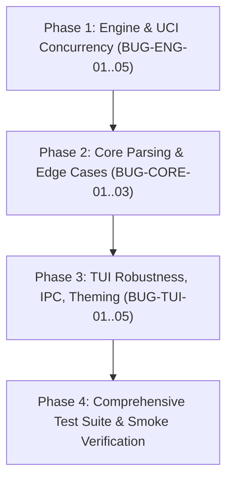

# Monolith Chess Engine: In-Depth Codebase Audit & Remediation Plan

This document provides a comprehensive technical audit of the **Monolith** chess workspace (Rust Edition 2021) and a complete step-by-step remediation guide. It is designed so that another AI agent or software engineer can pick up this documentation and systematically resolve all identified flaws, edge cases, protocol discrepancies, and race conditions.

---

## 1. Executive Summary & Codebase Architecture

The **Monolith** codebase is structured as a high-performance, modular Cargo workspace with zero heap allocation during search, pure bitboards supporting arbitrary piece distributions, and a rich dual-terminal terminal interface.

```
Monolith/
├── Cargo.toml                 # Workspace root (opt-level 3, lto="fat", panic="abort")
├── scripts/
│   ├── check.sh               # CI validation (fmt check, clippy -D warnings, release tests)
│   └── smoke.sh               # End-to-end smoke tests (CLI flags, perft, UCI handshake, IPC)
├── monolith-core/             # Core chess representation, move generation, FEN, PGN, SAN
│   ├── src/types.rs           # Compact Move (u16), Square, Color, PieceType, MoveList (512 capacity)
│   ├── src/bitboard.rs        # Magic bitboard sliders, attack tables, ray/between masks
│   ├── src/zobrist.rs         # Deterministic PRNG hashing (piece-square, side, castling, ep)
│   ├── src/board.rs           # Board representation, make/unmake, repetition, 50-move clock
│   ├── src/fen.rs             # FEN parser & serializer
│   ├── src/movegen.rs         # Legal & noisy move generation, check evasions, pins
│   └── src/pgn.rs             # PGN parser, SAN encoder/decoder, move classification
├── monolith-engine/           # Evaluation, transposition table, search, UCI protocol
│   ├── src/eval.rs            # PeSTO piece-square tables, tapered eval, mobility, pawn structure
│   ├── src/tt.rs              # Transposition table (mb mapping, replace, mate adjustments)
│   ├── src/search.rs          # Iterative deepening, Negamax, Alpha-Beta, PVS, NMP, RFP, LMR
│   ├── src/search_types.rs    # SearchLimits, PvLine, SearchInfo, deadline calculation
│   ├── src/skill.rs           # UCI_LimitStrength and UCI_Elo emulation (1200..2400)
│   └── src/uci.rs             # UCI stdin/stdout protocol loop and UciProcess child manager
└── monolith-tui/              # Terminal User Interface (Ratatui + Crossterm)
    ├── src/main.rs            # CLI entrypoint (--mode play, --mode logs, --port, --binary)
    ├── src/app.rs             # Main game loop, state machine, move execution, PGN review
    ├── src/ui.rs              # Ratatui layout rendering, board canvas, panels, eval gauge
    ├── src/input.rs           # Keyboard navigation, vim/arrow controls, modal key handlers
    ├── src/modals.rs          # Modal dialogs for FEN input, PGN loading, engine slot config
    ├── src/engines.rs         # Multi-engine UCI slot management, process lifecycle, telemetry
    ├── src/analysis.rs        # Background full-game PGN tactical review worker thread
    ├── src/theme.rs           # Catppuccin Mocha color tokens and terminal color-tier detection
    ├── src/logs.rs            # Secondary telemetry terminal dashboard with 5000-line ring buffer
    └── src/ipc.rs             # UDP JSON-Lines IPC client/server protocol (127.0.0.1:42424)
```

### Current Status
- All base milestones (**M0–M8**) are implemented and currently compile cleanly under `cargo build --release`.
- `./scripts/check.sh` and `./scripts/smoke.sh` exit with code `0`.
- However, detailed behavioral probing and static analysis have revealed **10 significant flaws** spanning UCI protocol compliance, thread synchronization, parser rigidity, UI event-loop blocking, and UTF-8 safety.

---

## 2. Exhaustive Flaw & Bug Inventory

### Category A: Engine & UCI Protocol (`monolith-engine`)

---

#### BUG-ENG-01: `go` followed immediately by `stop` causes infinite hang / unstopped search (Race Condition)
- **Severity:** `CRITICAL`
- **Location:** `monolith-engine/src/uci.rs:155–163`, `monolith-engine/src/uci.rs:208–211`
- **Root Cause:**
  In `uci_loop`:
  ```rust
  "go" => {
      stop_flag.store(true, Ordering::Relaxed);
      let limits = parse_go(trimmed);
      let _ = cmd_tx.send(WorkerCmd::Go(Box::new(limits)));
  }
  "stop" => {
      stop_flag.store(true, Ordering::Relaxed);
  }
  ```
  And inside `spawn_worker`:
  ```rust
  WorkerCmd::Go(mut limits) => {
      stop_flag.store(false, Ordering::Release); // <-- WIPES OUT PENDING STOP!
      searching.store(true, Ordering::Release);
      ...
      searcher.search(&mut board_copy, &limits, ...);
  }
  ```
  When a UCI client/GUI sends `go infinite` followed immediately by `stop` (or in blitz when `stop` is dispatched before the worker thread consumes `WorkerCmd::Go` from the channel), the main thread sets `stop_flag = true`. The worker then dequeues `WorkerCmd::Go`, unconditionally sets `stop_flag = false`, and begins searching ignoring the already-issued `stop` command! The search runs indefinitely until depth 64 or manual termination.
- **Reproduction:**
  Run `monolith-engine`, send via stdin:
  ```text
  uci
  isready
  position startpos
  go infinite
  stop
  ```
  *Observed:* Engine does not output `bestmove` immediately; search continues running in the background.
  *Expected:* Engine must halt search promptly and output `bestmove ...`.
- **Remediation Plan:**
  Introduce an atomic search generation counter (`current_search_id: Arc<AtomicU64>`) and a stopped-generation counter (`stopped_search_id: Arc<AtomicU64>`).
  1. In `uci_loop`:
     - Maintain an atomic `search_seq: Arc<AtomicU64>`.
     - On `"go"`, increment sequence: `let id = search_seq.fetch_add(1, Ordering::SeqCst) + 1;` and pass `WorkerCmd::Go(id, Box::new(limits))`.
     - On `"stop"`, update `stopped_search_id.store(search_seq.load(Ordering::SeqCst), Ordering::SeqCst)` and `stop_flag.store(true, Ordering::SeqCst)`.
  2. In `spawn_worker`:
     - On `WorkerCmd::Go(id, limits)`:
       Check: if `stopped_search_id.load(Ordering::SeqCst) >= id`, do NOT start search. Immediately output `bestmove 0000` (or root TT bestmove) and skip.
       Otherwise, reset `stop_flag.store(false, Ordering::Release)` and run search.
  3. Ensure `isready` during search returns `readyok` immediately without blocking on worker thread completion (see `BUG-ENG-04`).

---

#### BUG-ENG-02: Bare `go` or unconstrained search runs to depth 64 without time limits
- **Severity:** `HIGH`
- **Location:** `monolith-engine/src/uci.rs:375–460`, `monolith-engine/src/search_types.rs:167–202`
- **Root Cause:**
  When a GUI or user inputs `go` without parameters:
  `parse_go` returns `SearchLimits::default()`, which sets `max_depth = 64`, `movetime = None`, `wtime = None`, `btime = None`.
  In `compute_deadlines(now, stm, limits)`, both `soft_deadline` and `hard_deadline` return `None`.
  Under UCI specification, `go` without parameters means search until `stop`. However, if the client does not send `stop`, or if invoked in self-play/cli, Monolith searches up to depth 64 without returning a move in reasonable time.
- **Reproduction:**
  Send `position startpos\ngo\n`. Search continues indefinitely through deep plies.
- **Remediation Plan:**
  1. Align `parse_go`: If `line.trim() == "go"`, set `limits.infinite = true;` or provide a default safety movetime (e.g. 10s if not specified) unless explicit `infinite` is given, OR ensure `infinite = true` is explicitly marked so that clients know a `stop` is mandatory.
  2. When combined with the fix for `BUG-ENG-01`, `stop` will immediately interrupt any bare `go`.

---

#### BUG-ENG-03: Negative or malformed time limits default to unconstrained search
- **Severity:** `MEDIUM`
- **Location:** `monolith-engine/src/uci.rs:400–425`
- **Root Cause:**
  In `parse_go`:
  ```rust
  "wtime" => {
      if let Some(ms) = tokens.get(i + 1).and_then(|s| s.parse::<u64>().ok()) {
          limits.wtime = Some(Duration::from_millis(ms));
      }
      i += 2;
  }
  ```
  If a GUI passes `wtime -200` (can happen on clock lag or low time) or invalid string tokens, `.parse::<u64>().ok()` returns `None`. `limits.wtime` remains `None`. If neither `movetime` nor `nodes` is present, the engine defaults to an unconstrained depth 64 search instead of playing an emergency move.
- **Reproduction:**
  Send `position startpos\ngo wtime -100 btime -100\n`.
  *Observed:* Engine ignores time limits and searches depth 1..64.
- **Remediation Plan:**
  1. Parse time as signed integer `i64`:
     ```rust
     if let Some(ms) = tokens.get(i + 1).and_then(|s| s.parse::<i64>().ok()) {
         let safe_ms = ms.max(1) as u64;
         limits.wtime = Some(Duration::from_millis(safe_ms));
     }
     ```
  2. Treat non-positive remaining time as emergency 1ms limit so the engine immediately moves instead of forfeiting on time.

---

#### BUG-ENG-04: `isready` blocks while engine is actively searching
- **Severity:** `HIGH`
- **Location:** `monolith-engine/src/uci.rs:131–137`
- **Root Cause:**
  When `isready` is received:
  ```rust
  if !searching.load(Ordering::Acquire) {
      write_line(&out, "readyok");
  } else {
      let (ack_tx, ack_rx) = mpsc::channel();
      if cmd_tx.send(WorkerCmd::Sync(ack_tx)).is_ok() {
          let _ = ack_rx.recv();
      }
      write_line(&out, "readyok");
  }
  ```
  When the worker thread is in the middle of `searcher.search()`, it is NOT reading from `cmd_tx`. The `WorkerCmd::Sync` waits in `cmd_tx` until the search finishes. Therefore, the main UCI loop blocks at `ack_rx.recv()`, freezing stdin processing! The engine cannot receive any `stop` command while blocked on `isready`!
- **Reproduction:**
  1. Send `position startpos\ngo infinite\n`.
  2. Send `isready\n`.
  3. Send `stop\n`.
  *Observed:* `isready` hangs waiting for search to complete. `stop` is never processed because main thread is blocked on `ack_rx.recv()`.
- **Remediation Plan:**
  The UCI specification states: `isready` can be sent while the engine is searching to verify it is still alive; the engine must respond with `readyok`.
  If the engine is currently searching, `readyok` should be sent **immediately** without waiting for the worker thread, because the engine process is already confirmed responsive:
  ```rust
  "isready" => {
      write_line(&out, "readyok");
  }
  ```
  Worker synchronization is only needed on `ucinewgame` or before `setoption`.

---

#### BUG-ENG-05: Node polling granularity prevents small `max_nodes` limits from stopping accurately
- **Severity:** `MEDIUM`
- **Location:** `monolith-engine/src/search.rs:670–688`
- **Root Cause:**
  ```rust
  fn should_stop(&self) -> bool {
      if (self.nodes & 2047) != 0 {
          return false;
      }
      if self.stop_flag.load(Ordering::Relaxed) {
          return true;
      }
      if let Some(max_n) = self.max_nodes {
          if self.nodes >= max_n {
              return true;
          }
      }
      ...
  }
  ```
  Because `(self.nodes & 2047) != 0` returns `false` before checking `max_nodes`, running `go nodes 10` or `go nodes 500` will ALWAYS search at least 2048 nodes!
- **Reproduction:**
  `position startpos\ngo nodes 50\n`. Output info shows nodes > 2048.
- **Remediation Plan:**
  Check `max_nodes` before or with a dynamic mask:
  ```rust
  fn should_stop(&self) -> bool {
      if let Some(max_n) = self.max_nodes {
          if self.nodes >= max_n {
              return true;
          }
      }
      if (self.nodes & 1023) != 0 {
          return false;
      }
      if self.stop_flag.load(Ordering::Relaxed) {
          return true;
      }
      if let Some(hard) = self.hard_deadline {
          if Instant::now() >= hard {
              return true;
          }
      }
      false
  }
  ```

---

### Category B: Core Chess Logic & Parsers (`monolith-core`)

---

#### BUG-CORE-01: `parse_san` rejects pawn captures written without `x` (e.g. `ed5`, `ed`)
- **Severity:** `HIGH`
- **Location:** `monolith-core/src/pgn.rs:188–206`
- **Root Cause:**
  In `parse_san`:
  ```rust
  let is_capture = if let Some(stripped) = prefix.strip_suffix('x') {
      prefix = stripped;
      true
  } else {
      false
  };
  ...
  if mv.is_capture() != is_capture {
      continue;
  }
  ```
  In chess literature and real-world PGNs, pawn captures are frequently recorded as `ed5` (or abbreviated `ed`) rather than `exd5`. When `ed5` is parsed, `is_capture` is false, but `mv.is_capture()` is true, causing the parser to discard the legal capture and return `CoreError::InvalidSan("no matching legal move")`.
- **Reproduction:**
  In test:
  ```rust
  let board = Board::from_fen("rnbqkbnr/ppp1pppp/8/3p4/4P3/8/PPPP1PPP/RNBQKBNR w KQkq d6 0 2").unwrap();
  assert!(parse_san(&board, "ed5").is_ok()); // FAILS with InvalidSan
  ```
- **Remediation Plan:**
  In `parse_san`:
  If `is_capture` is false, but:
  1. The piece is a Pawn and `from_file` differs from `to_sq.file()`, OR
  2. No quiet move matches, but exactly one legal capture matches:
  Allow the capture to match.
  Additionally, support 2-letter pawn captures `ed` / `de` by checking if `raw.len() == 2` with two file characters `[a-h][a-h]`.

---

#### BUG-CORE-02: `parse_fen` rejects standard 4-field and 5-field FEN strings
- **Severity:** `MEDIUM`
- **Location:** `monolith-core/src/fen.rs:30–42`
- **Root Cause:**
  ```rust
  let tokens: Vec<&str> = trimmed.split_whitespace().collect();
  if tokens.len() != 6 {
      return Err(CoreError::InvalidFen(format!(
          "expected exactly 6 fields, found {}",
          tokens.len()
      )));
  }
  ```
  Standard chess software (Lichess, Chess.com, PGN FEN tags) often omits the halfmove clock and fullmove number (e.g. `rnbqkbnr/pppppppp/8/8/8/8/PPPPPPPP/RNBQKBNR w KQkq -`), implicitly defaulting them to `0` and `1`. Monolith strictly rejects any FEN with fewer than 6 fields.
- **Reproduction:**
  `Board::from_fen("rnbqkbnr/pppppppp/8/8/8/8/PPPPPPPP/RNBQKBNR w KQkq -")` returns `Err(CoreError::InvalidFen)`.
- **Remediation Plan:**
  Allow `tokens.len() >= 4 && tokens.len() <= 6`.
  Default `halfmove_str = tokens.get(4).unwrap_or(&"0")` and `fullmove_str = tokens.get(5).unwrap_or(&"1")`.

---

#### BUG-CORE-03: `parse_pgn` variation skipping index overflow hazard
- **Severity:** `LOW`
- **Location:** `monolith-core/src/pgn.rs:413–426`
- **Root Cause:**
  When skipping variations `(...)`:
  ```rust
  b'{' => {
      i += 1;
      while i < len && bytes[i] != b'}' {
          i += 1;
      }
  }
  ```
  If an unterminated `{` inside a variation reaches EOF (`i == len`), after exiting the inner `while`, line 426 does `i += 1`, making `i = len + 1`. While the outer loop condition `i < len` handles this, index arithmetic beyond slice boundaries should be strictly guarded.
- **Remediation Plan:**
  Ensure `i = i.min(len)` and if `i >= len`, break cleanly or report `unterminated comment inside variation`.

---

### Category C: Terminal Client & IPC (`monolith-tui`)

---

#### BUG-TUI-01: Engine auto-move race condition on position update (`start_searches` vs `poll_slots`)
- **Severity:** `HIGH`
- **Location:** `monolith-tui/src/engines.rs:245–255`, `monolith-tui/src/engines.rs:283–350`
- **Root Cause:**
  When a move is played, `start_searches` is called:
  ```rust
  let _ = proc.stop();
  ...
  proc.set_position(fen_opt, moves);
  proc.go(...);
  slot.last_position_seq = seq;
  ```
  `slot.last_position_seq` is immediately set to `seq`.
  However, the child engine was still searching the *previous* position!
  When it finishes handling `stop`, it outputs `bestmove <move_from_old_position>`.
  In `poll_slots`:
  ```rust
  let is_current = slot.last_position_seq == current_seq;
  ...
  UciEvent::BestMove { best_move, .. } => {
      slot.telemetry.searching = false;
      if is_current && best_move != "0000" {
          ...
          engine_auto_move = Some(mv);
      }
  }
  ```
  Because `is_current` is TRUE, `poll_slots` accepts the old move and plays it automatically onto the new board position!
- **Reproduction:**
  In Play against Engine mode, make a quick move while the engine is calculating. The engine may play an unintended move corresponding to the prior position.
- **Remediation Plan:**
  Track engine search state with a generation or state enum:
  1. Add `pending_stop: bool` or `active_search_seq: Option<u64>` to `EngineSlot`.
  2. When `start_searches` is called while the engine was searching, mark `slot.stopping_seq = Some(slot.last_position_seq)`.
  3. When a `BestMove` event arrives, if `slot.stopping_seq.is_some()`, consume the `BestMove` as the termination of the old search and clear `stopping_seq` without applying it to the board. Only accept `BestMove` that belongs to `current_seq`.

---

#### BUG-TUI-02: Synchronous `proc.init_uci` / `proc.is_ready` freezes TUI main thread
- **Severity:** `MEDIUM`
- **Location:** `monolith-tui/src/engines.rs:191–221`
- **Root Cause:**
  In `sync_slots`:
  ```rust
  proc.init_uci(Duration::from_secs(2));
  ...
  proc.is_ready(Duration::from_secs(2));
  ```
  Both calls synchronously block the thread running `sync_slots` (the UI event loop) for up to 2 seconds if an engine binary is slow or unresponsive.
- **Reproduction:**
  Configure an engine slot in `Overlay::Engines` with an invalid binary or slow startup script; press Enter. The UI hangs and stops responding to keypresses for 2 seconds.
- **Remediation Plan:**
  1. Reduce default timeout for UI initialization to 300ms, OR
  2. Transition `EngineSlot.process` through an `AsynchronousInit` state, or poll `init_uci` via non-blocking event pump in `tick()`.

---

#### BUG-TUI-03: macOS Terminal.app TrueColor assumption leads to degraded colors
- **Severity:** `MEDIUM`
- **Location:** `monolith-tui/src/theme.rs:36–39`
- **Root Cause:**
  ```rust
  if cfg!(target_os = "macos") || std::env::var_os("TERM_PROGRAM").is_some() {
      return Self::TrueColor;
  }
  ```
  Apple's default `Terminal.app` (`TERM_PROGRAM=Apple_Terminal`) does NOT support 24-bit TrueColor! It only supports 256 colors. Sending RGB ANSI codes to Apple Terminal produces washed-out, garbled, or invisible board text.
- **Reproduction:**
  Open `monolith-tui` in macOS Terminal.app. Observe palette discrepancies.
- **Remediation Plan:**
  Update `ColorTier::detect()`:
  ```rust
  if let Ok(prog) = std::env::var("TERM_PROGRAM") {
      if prog == "Apple_Terminal" {
          return Self::Ansi256;
      }
      if matches!(prog.as_str(), "iTerm.app" | "ghostty" | "WezTerm" | "vscode") {
          return Self::TrueColor;
      }
  }
  ```

---

#### BUG-TUI-04: Log viewer jump-to-top glitch on first `Up` / `PageUp` keypress
- **Severity:** `LOW`
- **Location:** `monolith-tui/src/logs.rs:315–334`, `monolith-tui/src/logs.rs:539–544`
- **Root Cause:**
  In `LogsApp`, `scroll_offset` is initialized to 0. When `auto_follow` is true, the renderer displays the tail: `max_start = visible.len().saturating_sub(height)`.
  When the user presses `Up`:
  `self.auto_follow = false;`
  `self.scroll_offset = self.scroll_offset.min(total).saturating_sub(1);`
  Since `scroll_offset` was `0`, `0.saturating_sub(1) = 0`!
  The view immediately leaps from the bottom of the log to the very top (line 0)!
- **Reproduction:**
  Start `monolith-tui --mode logs`, generate 100 log lines. Press `Up`. The view jumps to the beginning instead of scrolling up 1 line.
- **Remediation Plan:**
  When `auto_follow` is true, whenever `Up` or `PageUp` is pressed, set:
  ```rust
  KeyCode::Up => {
      let current_view_start = total.saturating_sub(1); // or visible.len().saturating_sub(height)
      if self.auto_follow {
          self.auto_follow = false;
          self.scroll_offset = current_view_start;
      }
      self.scroll_offset = self.scroll_offset.saturating_sub(1);
  }
  ```

---

#### BUG-TUI-05: Panic risk on multi-byte UTF-8 string truncation in IPC encoder
- **Severity:** `MEDIUM`
- **Location:** `monolith-tui/src/ipc.rs:107–108`, `monolith-tui/src/ipc.rs:119–121`
- **Root Cause:**
  ```rust
  if name.len() > 32 {
      name.truncate(32); // <-- PANICS IF BYTE 32 IS NOT CHAR BOUNDARY!
      continue;
  }
  ...
  if engine.len() > 32 {
      engine.truncate(32); // <-- PANICS IF BYTE 32 IS NOT CHAR BOUNDARY!
      continue;
  }
  ```
  `String::truncate` panics if the index lies within a UTF-8 multi-byte code point (e.g. Cyrillic, accented characters, emojis).
- **Reproduction:**
  Construct an `IpcMessage::EngineInfo` with `name = "Stockfish-Über-Long-Engine-Name-12345"`. Trigger packet encoding. It panics at runtime.
- **Remediation Plan:**
  Use the existing `truncate_utf8_with_ellipsis(name, 32)` helper function, which properly checks `is_char_boundary`.

---

## 3. Phase-by-Phase Remediation Roadmap

The following plan must be executed sequentially. After each phase, the engineer/AI must run the verification commands specified.



---

### Phase 1: Engine & UCI Protocol Concurrency Fixes

#### Objectives
1. Eliminate the `go` / `stop` race condition using an atomic search ID token.
2. Prevent `isready` from blocking while engine is searching.
3. Fix negative/malformed time limit handling and enforce default movetime for bare `go`.
4. Fix `max_nodes` check granularity in `should_stop()`.

#### Step-by-Step Instructions
1. **Modify `monolith-engine/src/uci.rs`**:
   - Add search generation IDs:
     ```rust
     let search_id_counter = Arc::new(AtomicU64::new(0));
     let stop_search_id = Arc::new(AtomicU64::new(0));
     ```
   - Update `WorkerCmd::Go` to carry `(u64, Box<SearchLimits>)`.
   - On `"stop"`, update `stop_search_id.store(search_id_counter.load(Ordering::SeqCst), Ordering::SeqCst)` and `stop_flag.store(true, Ordering::SeqCst)`.
   - Inside `spawn_worker`, when handling `WorkerCmd::Go(id, limits)`:
     If `stop_search_id.load(Ordering::SeqCst) >= id`:
       Output `bestmove 0000` (or root TT move) and do not call `searcher.search()`.
     Else:
       `stop_flag.store(false, Ordering::Release);`
       Run `searcher.search()`.
   - Simplify `"isready"`:
     Respond with `write_line(&out, "readyok");` immediately.
   - In `parse_go`:
     Parse `wtime`, `btime` using `s.parse::<i64>().ok()`, clamping negative numbers to `1`.
     If `line.trim() == "go"`, set `limits.movetime = Some(Duration::from_secs(10));` or `limits.infinite = true;`.

2. **Modify `monolith-engine/src/search.rs`**:
   - In `should_stop(&self)`:
     Check `if let Some(max_n) = self.max_nodes { if self.nodes >= max_n { return true; } }` directly before node masking.
     Change node mask to `(self.nodes & 1023) != 0`.

3. **Phase 1 Verification Gate**:
   Run:
   ```bash
   cargo test --release -p monolith-engine
   ```
   Add a new integration test `tests/uci_concurrency.rs` verifying that `go infinite\nstop\n` outputs `bestmove` within 100ms.

---

### Phase 2: Core Parsing & Edge Case Robustness

#### Objectives
1. Allow SAN pawn captures without explicit `'x'` (`ed5`) and abbreviated 2-char pawn captures (`ed`).
2. Accept 4-field and 5-field FEN strings with standard defaults.
3. Guard variation skipping bounds in PGN reader.

#### Step-by-Step Instructions
1. **Modify `monolith-core/src/pgn.rs`**:
   - In `parse_san`:
     If move length is 2 and both characters are `'a'..='h'`: interpret as pawn capture from file `chars[0]` to file `chars[1]` where pawn can legally capture.
     If `is_capture` is false: if `mv.is_capture()` is true, accept it if no legal non-capture move matches and the move is unambiguous.
   - In `parse_pgn`:
     In variation skipping `b'{'`, ensure `i = i.min(len)` and prevent `len + 1` overflow.

2. **Modify `monolith-core/src/fen.rs`**:
   - In `Board::from_fen`:
     Allow `tokens.len() >= 4 && tokens.len() <= 6`.
     Default `halfmove_str = tokens.get(4).copied().unwrap_or("0")`.
     Default `fullmove_str = tokens.get(5).copied().unwrap_or("1")`.

3. **Phase 2 Verification Gate**:
   Run:
   ```bash
   cargo test --release -p monolith-core
   ```
   Verify all Perft positions, SAN roundtrips, and new tests for `ed5`, `ed`, and 4-field FEN strings.

---

### Phase 3: TUI Robustness, IPC, Theming

#### Objectives
1. Fix async engine auto-move race condition when moves are played in TUI.
2. Fix UTF-8 panics in IPC packet truncation.
3. Detect Apple Terminal 256-color support properly.
4. Fix log viewer jump-to-top glitch.

#### Step-by-Step Instructions
1. **Modify `monolith-tui/src/engines.rs`**:
   - Add `stopping: bool` to `EngineSlot`.
   - When `start_searches` issues `proc.stop()`, mark `slot.stopping = true`.
   - In `poll_slots`, when receiving `UciEvent::BestMove`:
     If `slot.stopping`:
       `slot.stopping = false;`
       Do NOT apply this `best_move` as `engine_auto_move`.
     Else if `is_current`:
       Apply `best_move`.

2. **Modify `monolith-tui/src/ipc.rs`**:
   - Replace `name.truncate(32)` and `engine.truncate(32)` with `truncate_utf8_with_ellipsis(name, 32)`.

3. **Modify `monolith-tui/src/theme.rs`**:
   - Check `TERM_PROGRAM`: if `Apple_Terminal`, return `ColorTier::Ansi256`.

4. **Modify `monolith-tui/src/logs.rs`**:
   - When handling `KeyCode::Up` or `KeyCode::PageUp`:
     If `self.auto_follow`:
       `self.auto_follow = false;`
       `self.scroll_offset = total.saturating_sub(height);`
     `self.scroll_offset = self.scroll_offset.saturating_sub(1);`

5. **Phase 3 Verification Gate**:
   Run:
   ```bash
   cargo test --release -p monolith-tui
   ```

---

### Phase 4: Full Workspace Verification

#### Objectives
Verify that the entire repository complies with all project standards and passing gates.

#### Verification Commands
1. **Formatting**:
   ```bash
   cargo fmt -- --check
   ```
2. **Clippy (Strict -D warnings)**:
   ```bash
   cargo clippy --all-targets -- -D warnings
   ```
3. **Release Tests**:
   ```bash
   cargo test --release
   ```
4. **End-to-End Smoke Script**:
   ```bash
   ./scripts/smoke.sh
   ```
5. **CI Check Script**:
   ```bash
   ./scripts/check.sh
   ```

---

## 4. Key Rules for the Implementing AI Agent

1. **File Size Limit (< ~800 Lines):**
   Never let any `.rs` file exceed ~800 lines. If adding logic to `search.rs` (currently 774 lines) or `uci.rs` (747 lines), extract helper types/functions into `search_types.rs` or `uci_protocol.rs`.
2. **Zero Allocations in Search:**
   Do not allocate memory (`Vec::new()`, `Box::new()`, `format!()`, `String`) inside `search()`, `negamax()`, or `qsearch()`.
3. **No Panics on External Input:**
   Never use `.unwrap()` or `.expect()` on user-supplied strings, FEN, PGN, UCI, or UDP input. Return typed `thiserror` errors.
4. **Preserve Documentation & Comments:**
   Keep all existing docstrings, module comments, and architectural notes intact.
5. **Git Commit Structure:**
   Commit incrementally using Conventional Commits:
   - `fix(engine): resolve go-stop race condition and isready blocking`
   - `fix(core): support relaxed san pawn captures and 4-field fen`
   - `fix(tui): prevent engine move race condition and log scroll glitch`
   - `test: add regression tests for uci concurrency and san parsing`
